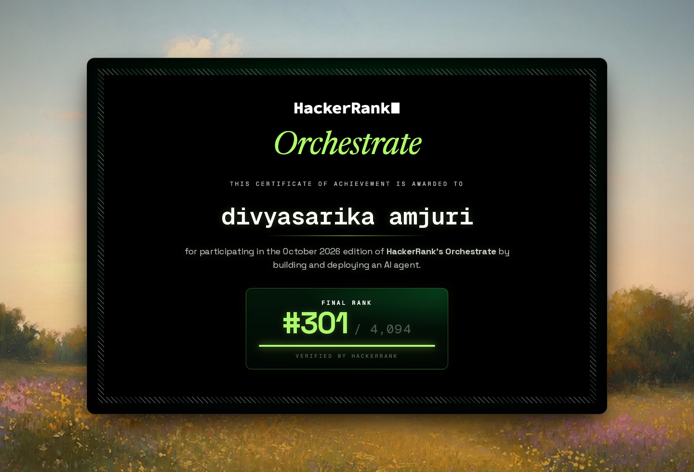

# 🏆 Data Deletion Audit Agent: HackerRank Orchestrate Hackathon

**AI Agent · Python · SQL · Claude API** · HackerRank Orchestrate, October 2026

> **Final rank: #301 of 4,094 participants (top 8%)** · Certificate of Achievement, verified by HackerRank



## 🎯 The Problem

When a person asks a company to delete their data (as under GDPR), the data has to be removed from every system: databases, backups, logs, documents, search indexes and more. The challenge, called **"Ghost Data Still Exists"**, was to build an AI agent that checks whether a deletion request was really completed, or whether copies of the person's data were still left somewhere.

For each of **518 deletion requests**, the agent had to decide:

- whether the deletion is `COMPLETE`, `INCOMPLETE`, or `NOT_APPLICABLE` (the person never asked for deletion)
- which records still expose the person, and which syncs or backups could bring the data back
- the ordered steps to fix it (findings → remediation → verification)

## 🛠 My Approach

```
evidence files ──► parse into one record shape ──► match the person (current + old emails, IDs)
      ──► find every linked record ──► state at audit time ──► apply deletion rules ──► ordered steps
```

1. **Collected the evidence.** Parsers read many file types (SQL database copies, JSON, five different log styles, text handover notes, PDFs and screenshots) and turn each one into a simple record: which system, which record, what state, and whether personal data is still exposed.
2. **Found the person everywhere.** Each request is matched to the person's user ID and all their past emails, phone numbers and email hashes, so no copy is missed.
3. **Traced where the data went.** Followed data lineage (for example a sync job that recreated a deleted search entry) to find hidden downstream copies.
4. **Checked what was really there.** Only evidence captured between the request and the audit date counts. If any database copy (primary or replica) still holds the data, it is still present. A "SUCCESS" message in a log is treated as a claim, not proof.
5. **Built the clean-up plan.** The company's deletion rules decide each record: delete, redact, anonymize or keep (security logs, legal holds). Data flows are disabled and backup restores blocked before anything is deleted.
6. **Used AI where it helps.** Claude reads multilingual request text and admin-console screenshots. A rule-based backup (keyword rules + OCR) lets the agent run fully without paid API access.

**My role:** I studied the problem and the evidence data, planned how the agent should work step by step, decided the matching and checking rules, and tested the agent on the sample cases to find and fix weak spots. I used Claude Code as a coding assistant to write the code faster.

## 📊 Results

On the 32 public sample cases:

| Measure | Score |
| --- | ---: |
| Deletion status accuracy | **100%** |
| Step F1 score (right deletion steps found) | **0.984** |
| Exact step order | **84.4%** |
| Custom test cases I wrote | 5 of 5 passing |

Final ranking: **#301 out of 4,094** participants worldwide.

## 💡 What I Learned / What I'd Improve

- Real-world data is messy: most of the work was turning many file formats into one clean, consistent shape.
- Simple rules first, AI second: rules handled exact matching reliably, and AI helped with the unclear parts.
- From the judges' feedback, next time I would:
  - make missing or unreadable evidence block a `COMPLETE` decision
  - build the output checks into the main run
  - report results for the AI path and the fallback path separately

## 📁 Folder Structure

```
code/
  main.py                 entry point
  requirements.txt
  audit/                  the agent
    extract.py            evidence parsers (SQL, JSON, logs, text, PDF, images)
    identity.py           current + historical identity matching
    intent.py             is this really a deletion request? (Claude + keyword fallback)
    engine.py             discovery, state at audit time, policy, ordered plan
    media.py              PDF text + screenshot reading (Claude vision / OCR)
    llm.py                Claude API wrapper with caching and token tracking
  evaluation/
    main.py               scoring against the sample answers
    custom_cases.py       5 custom test cases
    evaluation_report.md  metrics, failures found, improvements made
    usage_report.md       token usage and cost of the final run
```

## ▶️ How to Run

The challenge dataset belongs to HackerRank and is not included here. Clone the [official starter repo](https://github.com/interviewstreet/hackerrank-orchestrate-october26) for the `dataset/` folder, then copy `code/` next to it:

```bash
pip install -r code/requirements.txt
python3 code/main.py --no-llm             # free, rule-based run -> output.csv
python3 code/evaluation/main.py --custom  # scores on samples + custom cases
```

Set `ANTHROPIC_API_KEY` and drop `--no-llm` to use Claude for request text and screenshots.

## 🧰 Skills Used

Python · SQL · Data cleaning & parsing · Data lineage · Data validation · LLM APIs (Claude) · Prompt engineering · Building AI agents
