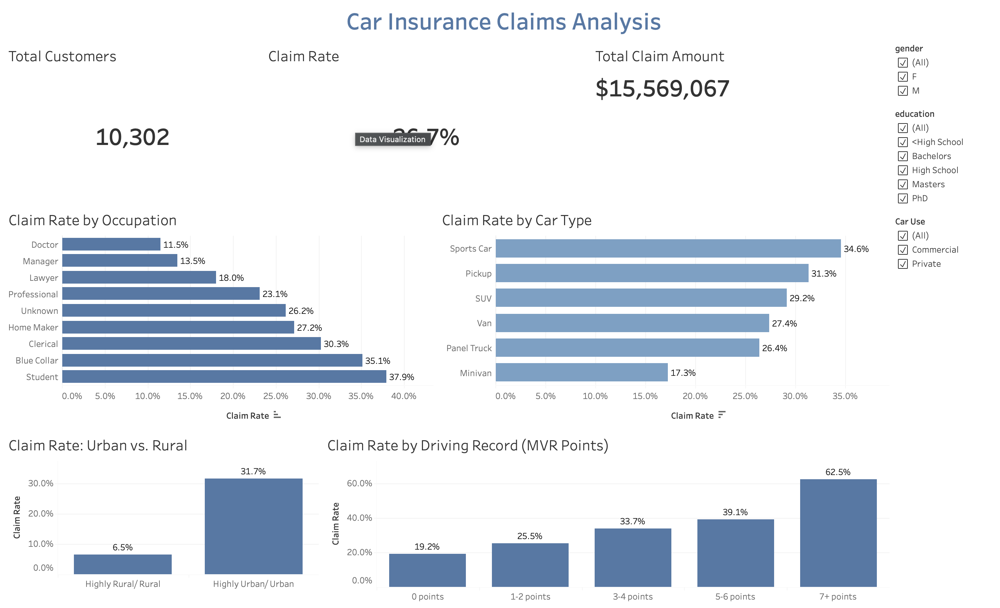

# 🚗 Car Insurance Claims Analysis (Tableau)

An interactive Tableau dashboard that explores **which customers are most likely to file a car insurance claim**, using data on 10,000+ policyholders.

🔗 **[View the live dashboard on Tableau Public](https://public.tableau.com/app/profile/divyasarika.amjuri/viz/CarInsuranceClaimsAnalysis_17933929786400/CarInsuranceClaimsAnalysis)**

---

## 📌 Business Question

Insurance companies need to understand which customers carry higher risk so they can price policies fairly and focus on prevention. This project answers:

- What share of customers file a claim, and how much is paid out?
- Which occupations, car types, and areas have the highest claim rates?
- How strongly does a driver's record predict claims?

---

## 📊 Dataset

- **Source:** [Car Insurance Claim Data (Kaggle)](https://www.kaggle.com/) – `car_insurance_claim.csv`
- **Size:** 10,302 rows, 27 columns
- **Key fields:** occupation, car type, urban/rural area, motor vehicle record points (MVR_PTS), claim flag, claim amount, car value (Bluebook), income, education, gender

---

## 🧹 Data Cleaning (in Tableau)

- Converted **5 currency columns** (CLM_AMT, OLDCLAIM, BLUEBOOK, INCOME, HOME_VAL) from text like `"$14,230"` into numbers using calculated fields
- Removed the **"z_" prefix** from values in 6 columns (e.g., `z_Blue Collar` → `Blue Collar`)
- Labeled **665 missing occupations** as "Unknown" so they appear clearly in charts
- Set **1 invalid car age** (-3 years) to blank
- Left other missing numeric values blank (instead of filling with 0) so averages stay accurate
- Identified **1 exact duplicate record** (0.01% of data); impact on results was negligible
- Grouped MVR points into **5 bands** (0, 1–2, 3–4, 5–6, 7+) to avoid misleading rates from very small groups

---

## 📈 Dashboard Contents

**KPIs:** Total Customers · Claim Rate · Total Claim Amount

**Charts:**
1. Claim Rate by Occupation
2. Claim Rate by Car Type
3. Claim Rate: Urban vs. Rural
4. Claim Rate by Driving Record (MVR Points)

**Filters:** Gender · Education · Car Use (applied to all charts and KPIs)

**Key metric:** Claim Rate = % of customers who filed a claim (average of the 0/1 claim flag). Using a rate instead of a count compares groups fairly, regardless of their size.

---

## 💡 Key Insights

- **Overall:** 26.7% of customers filed a claim (about 1 in 4), with **$15.57M** in total claims and an average claim of about **$5,670**.
- **Area:** Urban customers have a **31.7%** claim rate vs. **6.5%** for rural customers, about **5x higher**, the biggest difference in the data.
- **Driving record:** Claim rate rises steadily with MVR points, from **19.2%** (0 points) to **62.5%** (7+ points), more than **3x higher**.
- **Occupation:** Students (**37.9%**) and Blue Collar workers (**35.1%**) have the highest claim rates; Doctors (**11.5%**) and Managers (**13.5%**) the lowest.
- **Car type:** Sports cars (**34.6%**) have about **2x** the claim rate of minivans (**17.3%**).

> Note: these are associations, not proof of cause. For example, urban areas are linked with higher claim rates, likely due to heavier traffic.

---

## ✅ Recommendations

- Use **driving record** and **urban/rural location** as key factors in risk-based pricing.
- Offer **safe-driver programs or discounts** to encourage customers with violations to improve.
- Target **prevention campaigns** at higher-risk groups, such as young drivers/students and sports car owners.

---

## 🛠️ Tools

- **Tableau Public** – data cleaning (calculated fields), visualization, dashboard design
- **Kaggle** – data source
